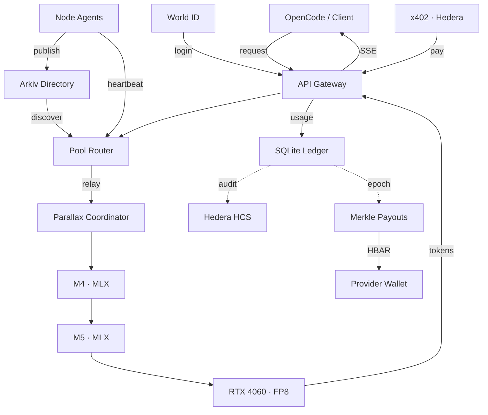

# GPU Pool

Large AI models exceed the memory of many everyday laptops, while nearby GPUs sit idle.
Connecting those machines is only half the problem: an open network also needs identity, live discovery, fair accounting and payments.

**GPU Pool combines nearby Apple and NVIDIA computers into one model-serving pool.** Providers contribute compute and earn credits; anyone can send prompts through an OpenAI-compatible API using credits or x402 payments. Built for ETHGlobal Mumbai 2026, with Qwen3-14B tested across an M4, an M5 and an RTX 4060 over Ethernet.

[Live app](https://gpupool-ethglobal.vercel.app) · [API keys](https://gpupool-ethglobal.vercel.app/keys) · [Architecture board](https://www.tldraw.com/f/Kq9M9uby0mhMJEGD5rgsq)

## Our approach

The **gateway chooses a pool; Parallax chooses its GPU stages**. Model layers stay on the workers, which exchange hidden states over Ethernet. A scoped outbound relay connects each private coordinator to the central gateway. Marketplace signing and payment keys stay central.



- **World ID** links accounts and budgeted API keys to verified humans.
- **Arkiv** provides expiring node/pool listings. Routing also checks fresh signed heartbeats and layer coverage.
- **SQLite + Hedera** handle atomic credit holds, usage settlement and an asynchronous signed audit trail. Credits split 90% to serving nodes by layers, 5% burn and 5% reserve. Successful direct x402 requests allocate 80% of HBAR income to providers through epoch-based Merkle claims.
- **OpenCode tools run on the requester’s laptop.** The gateway translates model tool calls into the OpenAI protocol.

## Set up and use

### Call the live API

Log in with World ID on the [app](https://gpupool-ethglobal.vercel.app), create a capped key on **Keys**, and export it locally:

```bash
export GPUPOOL_API_KEY='your-api-key'
export GPUPOOL_BASE_URL='https://ethglobal.yash-agrawal.dev'

curl "$GPUPOOL_BASE_URL/v1/chat/completions" \
  -H "Authorization: Bearer $GPUPOOL_API_KEY" \
  -H 'Content-Type: application/json' \
  -d '{"model":"Qwen/Qwen3-14B-FP8","messages":[{"role":"user","content":"Explain GPU pooling briefly."}],"max_tokens":128,"stream":true}'
```

Available models: `GET /v1/models`. For **OpenCode**, copy the configuration from Keys into your project’s `opencode.json`, then run `opencode`. See the [OpenCode guide](docs/OPENCODE.md) for configuration and context limits. Requests require a ready pool and spend credits; x402 payments use Hedera testnet.

### Contribute a laptop

Open [Become a provider](https://gpupool-ethglobal.vercel.app/getting-started). Choose **Create Pool** or **Join Pool ID**, log in with World ID, and enter your payout address. The coordinator approves members; each owner runs the generated one-command helper locally.

The helpers discover Ethernet IPs, prepare dependencies, download each model format once on the coordinator, transfer and verify caches, and synchronize node startup. Keep the helper running; progress appears on the frontend. Supported hosts need Python 3.10+, Git, Apple developer tools or working NVIDIA drivers, and owner-approved network access. Details: [provider onboarding](docs/PROVIDER-ONBOARDING.md).

### Run your own gateway and frontend

Requires **Node.js 24+** and **pnpm**:

```bash
git clone https://github.com/agrawalx/Ethglobal-mumbai.git
cd Ethglobal-mumbai
pnpm install
cp -n gateway/.env.example gateway/.env
cp -n frontend/.env.example frontend/.env.local
```

Configure `gateway/.env` with your World, JWT/signing, Arkiv and Hedera testnet credentials. Set `PUBLIC_URL` to the reachable gateway URL and `CORS_ORIGINS` to your frontend origin. Set `VITE_GATEWAY_URL` in the frontend; platform secrets belong only on the gateway. A fresh deployment also needs the Arkiv model catalog seeded, funded directory writers and a deployed payout contract for HBAR claims.

Run in separate terminals:

```bash
pnpm --filter @gpupool/gateway start   # localhost:8080
pnpm --dir frontend dev              # localhost:5173
```

Use trusted HTTPS for World phone login and remote helpers. Then onboard a pool through the frontend; starting the web services alone does not create inference capacity. See [gateway configuration](gateway/README.md), [pool bootstrap](docs/POOL-KICKSTART.md) and the [live runbook](docs/LIVE-DEMO-RUNBOOK.md).

## What challenged us

- **Mixed hardware:** NVIDIA FP8 and Apple MLX need different model snapshots but must serve the same layer pipeline.
- **Mac memory pressure:** oversized KV caches caused swapping and stalls. Bounded caches and a 4K sequence limit made the tested pool usable.
- **Pool lifecycle:** stale peers, orphaned processes and untimed joins broke placement. Process-group cleanup, runtime hooks and synchronized starts helped recovery.
- **Agent compatibility:** tool schemas, small context windows and missing stream finish markers made OpenCode harder than ordinary chat. The adapter must preserve tool turns and completion semantics.
- **Accounting across services:** inference, HCS and chain settlement finish at different times. Atomic local transactions, durable retries and explicit pending receipts keep those states separate.

## What’s next

- Redesign and calibrate **output verification**; it is currently disabled.
- Improve recovery from failed pipeline stages and reduce coordinated restarts.
- Tune batching, context capacity and model placement across more hardware, including MoE models.
- Test WAN pools and make installation and network diagnostics easier.
- Batch provider claims to reduce gas overhead; harden the system before considering mainnet payments.

For implementation details, see the [specification](docs/SPEC.md) and [engineering handoff](docs/HANDOFF.md).

## Sponsor tracks

**Arkiv**
- Catalog writer: `0xfeb19eb223236427a31b2d909851025abc55db1b` (Rabdi, chain 7794095)
- Docs: [why-arkiv.md](arkiv/why-arkiv.md) · [how-you-use-arkiv.md](arkiv/how-you-use-arkiv.md) · [schema.md](arkiv/schema.md) · [friction.md](arkiv/friction.md) · [reach.md](arkiv/reach.md) · [arkiv/](arkiv/)
- Query: `cd arkiv && node --env-file=.env src/cli.ts list-models`

**Hedera x402**
- Payments: [`0.0.9185802@1794018731.489265813`](https://hashscan.io/testnet/transaction/0.0.9185802-1794018731-489265813) · [`0.0.9185802@1794016459.379155319`](https://hashscan.io/testnet/transaction/0.0.9185802-1794016459-379155319) · top-up [`0.0.9185802@1794011853.698529921`](https://hashscan.io/testnet/transaction/0.0.9185802-1794011853-698529921)
- Agent `0.0.11332604` → treasury `0.0.11331600`; facilitator `0.0.9185802`
- HCS topic: [`0.0.11332608`](https://hashscan.io/testnet/topic/0.0.11332608) · EpochPayout: `0x22aafc9cbdafd4e5a7e7eae47b27cad48ad8b82c`
- Docs: [Hedera qualification requirements](docs/HEDERA_QUALIFICATION_REQUIREMENTS.md) · [gateway/README.md](gateway/README.md#x402-step-24)

**World ID**
- `WORLD_APP_ID=app_3defa81f175967a96109b1a628927bb6` · `WORLD_RP_ID=rp_831104fa5fd04dd5` · `WORLD_ACTION=gpupool-account` · `WORLD_ENVIRONMENT=staging`
- Docs: [WORLD_IDKIT_SUBMISSION.md](docs/WORLD_IDKIT_SUBMISSION.md)
