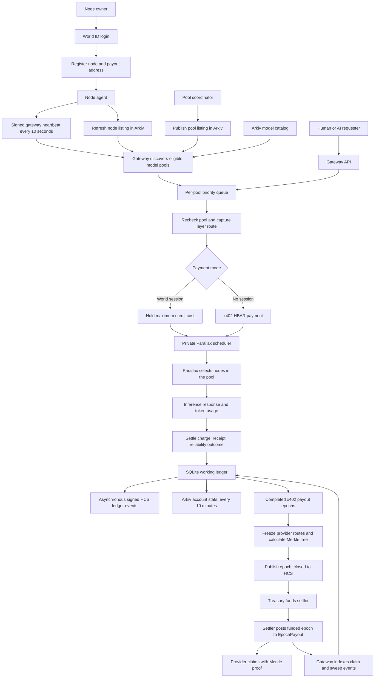

# GPU Pool MVP workflow

## Current status

Since the GitHub commit `11d46fa` fetched for this workspace, substantial backend work has been added locally. The current code implements Arkiv model and pool discovery, heartbeat-based reliability, priority queueing, missing APIs, scheduled Arkiv account statistics, x402 epoch settlement, Merkle proofs, provider payout tracking, and a provider claim CLI.

Local verification passed: 79 gateway tests, 42 shared tests, 10 Arkiv tests, and 17 Solidity tests (148 total), plus gateway, shared, and Arkiv typechecks. The complete local backend demo passed twice. These checks use local fixtures. They do not prove live World login, inference across the three physical nodes, or a public-testnet payout by this version of the gateway. Public-testnet checks are now authorized and remain a separate follow-up. Frontend work remains outside this backend workflow. Changes are local and uncommitted; nothing has been pushed.

## End-to-end workflow

## 1. Identity and node registration

1. A person completes World ID verification and receives a gateway session/account.
2. The account registers a node and its owner payout address.
3. The node agent signs heartbeats for the gateway. The expected default interval is 10 seconds.
4. The agent refreshes its expiring Arkiv node listing. The pool coordinator publishes the Arkiv pool listing.
5. Node listings include model, hardware, online state, reliability, and layer range. Private keys and World nullifiers are not published as account statistics.

## 2. Model discovery and routing

1. `GET /v1/models` intersects the Arkiv model catalog with configured billing models and pools that are ready now.
2. A pool is eligible when its model matches, its coordinator URL hash matches the configured private coordinator, it has members, each member has a fresh online heartbeat, and the reported layer ranges cover the model exactly once.
3. Pool reliability is the minimum reliability of its members. Load is `active requests / (active requests + 1)`. The router ranks by `reliability × (1 − load)` and breaks ties by pool ID.
4. If Arkiv is unavailable or no eligible pool exists, the gateway returns `503` with `Retry-After`. It does this before accepting payment. There is no hidden route to another inference service.
5. Parallax chooses the actual nodes inside the selected pool. The gateway records the heartbeat-derived layer route for accounting.

## 3. Admission and request handling

1. The gateway validates the OpenAI-compatible request and resolves its account session or x402 payment path.
2. Each pool has one active inference slot. Waiting requests are ordered by contribution ratio, highest first; ties are FIFO. x402 requests use ratio `1`. A waiting request does not hold credits or pay x402.
3. When a slot opens, the gateway rechecks pool readiness and captures the current layer map. A cancelled request is removed from the queue.
4. For a session request, the gateway holds the maximum estimated credit cost before inference. The cost uses the configured model factor and estimated input/output token budget. On success it settles actual usage and releases the unused hold. Failed or cancelled work releases the hold under the MVP rules.
5. For a no-session request, x402 settles HBAR to the configured treasury before inference. An already-paid x402 request is not refunded for an inference failure.
6. The gateway forwards to the private Parallax scheduler and returns either a JSON completion or an SSE stream with usage. Parallax remains private on loopback; it is not a public API.

## 4. Ledger, receipts, and reputation

1. SQLite is the working ledger for accounts, holds, requests, signed events, provider snapshots, and payout epochs.
2. Successful completion records usage, route, receipt, billing settlement, and provider attribution atomically. The payout address is frozen with the request so later account changes cannot redirect earlier earnings.
3. Session-credit distribution follows the SPEC: 90% to serving nodes, 5% burned, and 5% to the network reserve, subject to the self-request rule. Reliability is not a credit penalty.
4. A completed request outcome updates reliability. The score is `0.7 × success rate + 0.3 × uptime`; uptime is derived from expected heartbeat slots over the rolling seven-day window. Missing history starts at `0.8`.
5. Signed ledger events are queued to Hedera Consensus Service asynchronously. A request does not wait for HCS confirmation.
6. `GET /requests/:id` returns the receipt and HCS confirmation when available. `GET /ledger/events` returns recent signed events and their nullable HCS sequence numbers.

## 5. Public APIs

- `GET /v1/models`: Arkiv models that have an eligible live pool.
- `GET /network`: Arkiv pools and nodes with current gateway load and reliability; it does not reveal the private coordinator URL.
- `GET /me`: the signed-in account, balance, ratio, registered nodes, and reliability.
- `GET /ledger/events?limit=50`: recent signed ledger events, with HCS sequence numbers when confirmed.
- `GET /payouts/:address`: confirmed payout epochs and provider Merkle proofs.
- `POST /v1/chat/completions`: OpenAI-compatible session-credit or x402 inference.

## 6. Arkiv account-stat publishing

When the gateway has an Arkiv writer key configured, it publishes account statistics once at startup and then every 600 seconds. Entries are owner-scoped and expire after 86,400 seconds. The writer updates existing owner entries and does not write on every inference request. Published statistics include cumulative earned/spent values, contribution ratio, and minimum node reliability when available. Nullifiers, JWTs, payout keys, and private credentials are excluded. Individual account failures do not stop the rest of the batch; the next scheduled batch retries.

## 7. Epoch settlement and provider payout

1. The settlement worker closes completed x402 request epochs (default 600 seconds). It waits for in-flight x402 requests before freezing an epoch.
2. Successful paid requests allocate 80% of eligible HBAR income to providers, 10% to the network reserve, and 10% to operations, following the MVP payout rules. Provider shares use the frozen request routes and per-layer integer floors. Self, missing, unknown, and rounding shares remain outside provider payouts. Duplicate payment IDs count once.
3. The gateway saves the immutable payout list and sorted Merkle tree, then publishes the signed `epoch_closed` event to HCS. It waits for HCS confirmation before funding or posting the epoch. Empty epochs are audited but are not posted to the contract.
4. The treasury sends the exact provider total to the settler account. The settler calls `postEpoch` on the configured Hedera testnet `EpochPayout` contract. Raw signed transactions and hashes are persisted before broadcast so a restart can safely resume. Reverts or a conflicting root stop the worker for review.
5. Providers use `gateway/scripts/claim-payout.ts` with their private key in the ignored provider environment file. The CLI previews and simulates by default. `--broadcast` is required to send a claim transaction; `--epoch` selects one epoch.
6. The gateway indexes contract `Claimed` and `Swept` events, updates payout status idempotently, and submits signed `payout_claimed` ledger events to HCS.
7. Payout API results include only confirmed posted/swept epochs and the proof data needed to claim. Claimable time follows the contract delay.

The Hedera mirror and Hashio RPC were checked during this task. The deployed contract at `0x22aafc9cbdafd4e5a7e7eae47b27cad48ad8b82c` (Hedera `0.0.11332808`) has deployed bytecode. Hashio reported chain ID `296`, settler `0x14ff4f7615ef8e3cca82adf879f3be4051780a94`, and a 60-second claim delay at block `42726005`. The mirror returned only the deployment result for this contract; no epoch-post or claim transactions were present in that result list at the time checked. See [HashScan contract](https://hashscan.io/testnet/contract/0.0.11332808). This verifies the existing deployment, not the newly implemented settlement worker. The worker still needs configured treasury/settler credentials and testnet funding before it can post a live epoch.

## 8. Local verification and public-testnet status

The recorded local verification was:

- `pnpm --filter @gpupool/gateway test` — 79 passed.
- `pnpm --filter @gpupool/shared test` — 42 passed.
- `pnpm --filter @gpupool/arkiv test` — 10 passed.
- `forge test` — 17 passed.
- Gateway, shared, and Arkiv typechecks passed.
- `pnpm --filter @gpupool/gateway test:demo` — two full local fixture runs passed.

A read-only Arkiv catalog query previously returned the Qwen3 8B and 14B model entries. These results do not prove that the current gateway has a live ready pool. The workspace has no ignored gateway runtime config, provider config, or contract runtime config; `Env.md` contains setup templates only. No transaction was sent in this task. Remaining public-testnet work is to configure the ignored runtime files on the gateway host, verify the live pool and HCS writer, then exercise a real paid inference epoch and provider claim with funded testnet accounts. The current checkout cannot verify the required three-machine pool or safely run those steps without that runtime configuration and the node hosts. Record transaction IDs and explorer links here only after each action is confirmed. Never substitute fixture results for live evidence. Never use mainnet.

## 9. Current boundaries

- Frontend implementation is still separate.
- The local demo fixtures are not the three physical Parallax nodes.
- A catalog entry is not proof of an online serving pool.
- Contract deployment is not proof of a funded epoch or provider claim.
- Local edits are uncommitted and have not been pushed.
