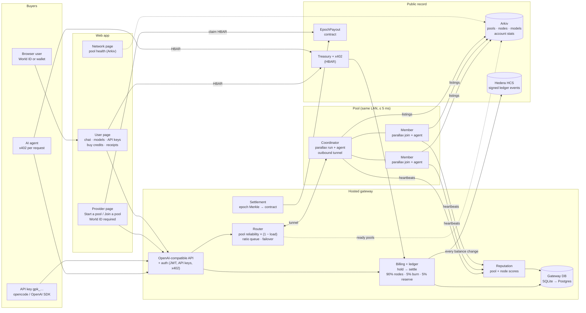

# GPU Pool Network — High-Level Design

Laptops on one LAN form a **pool** that runs a model no single laptop can run (Parallax splits the
layers). A **hosted gateway** sells that compute through an OpenAI-compatible API, pays providers in
proportion to the layers they serve, and records every balance change on Hedera.

## 1. System diagram

## 2. Components

| Component | Responsibility | Built? |
|---|---|---|
| **User page** | Chat (model picker from Arkiv), receipts (route, layers, cost, HCS link), balance + ratio, API keys, buy credits | Chat/receipts ✅ · API keys & buy credits: in progress (friend) |
| **Provider page** | "Start a pool" / "Join a pool" guides, info exchange, firewall rules, my nodes, earnings, payouts | Guide + node confirm ✅ · two-role page: to build |
| **Network page** | Pool health from Arkiv: status, reliability, members, capacity, layer map, model, heartbeats | ✅ |
| **World ID** | One account per human (Orb or Selfie). **Required for providers**; gives 10,000 starter credits | ✅ live-tested (simulator) |
| **Wallet sign-in + API keys** | Buyers without World ID; `gpk_…` keys work with any OpenAI-compatible client | Planned (friend) |
| **Gateway API** | OpenAI-compatible; the only public entry point | ✅ |
| **Router** | Arkiv ready pools → filters (fresh heartbeats, complete layers, not restarting) → `pool reliability × (1 − load)` → per-pool priority queue (ratio) → 1 failover → 503 + Retry-After | ✅ |
| **Billing / ledger** | Hold max cost, settle real cost, split 90/5/5 by layers, self-request → reserve, vesting 1 h | ✅ |
| **Reputation** | **Pool** (router score): 0.7 × success + 0.3 × uptime. **Node**: blame, caps, display | ✅ |
| **Settlement** | Each epoch: x402 (+ purchased credits) income → 80% providers by layers → Merkle root → contract | ✅ (x402) |
| **Coordinator** | `parallax run` scheduler (API private), node agent, **outbound tunnel** to the hosted gateway | Scheduler ✅ · tunnel: to build |
| **Members** | `parallax join -s <coordinator>`; node agent (heartbeats, Arkiv listing) | ✅ |

## 3. Data stores

| Store | What lives there | Why there |
|---|---|---|
| **Gateway DB** | `balances` (starter / earned / vesting / held), `earned_lots`, `requests` + receipts, `nodes`, pool & node reliability, API keys, epochs/payouts | Fast, private working copy for money logic |
| **Hedera HCS** | Signed event for every balance change (`starter_grant`, `request_settled`, `x402_payment`, `credits_expired`, `epoch_closed`, `payout_claimed` …) | Public audit log; balances can be rebuilt from it |
| **Arkiv** | Pools (models, members, status, layer map, **reliability**), nodes (GPU, memory, layers, tok/s, reliability, owner), models, account stats | Public directory; listings expire when a machine stops |
| **EpochPayout contract** | Merkle root + HBAR per epoch; claims | Trust-minimised HBAR payouts |

## 4. Key flows

**Buy and use compute**
1. User logs in (World ID → 10,000 starter credits) or signs in with a wallet and buys credits; or uses an API key; or an agent pays per request with x402.
2. Gateway router picks the best ready pool → request goes down the coordinator's tunnel → Parallax runs the layers across the pool → tokens stream back.
3. Gateway settles the real cost: 90% to node owners by layers served (0 on their own requests), 5% burn, 5% reserve → event on HCS → receipt shows route, cost, HCS link.

**Provide compute**
1. Owner verifies with World ID (mandatory).
2. Coordinator: `gpupool-node coordinate` → starts the scheduler + tunnel → registers the pool → shares the join card (scheduler address, network name, model, flags).
3. Members: `gpupool-node join --pool <id>` → delay check (≤ 5 ms to every member) → join request → coordinator approves → firewall rules between member IPs → `parallax join -s …`.
4. Pool turns **ready** when every layer is covered exactly once → elected member publishes the pool listing (+ pool reliability) on Arkiv.
5. Earnings: credits per request (vest 1 h, spend on any pool) and HBAR per epoch from paid demand (claim from the contract).

**Info a pool must exchange**

| From → to | Information |
|---|---|
| Coordinator → members | Scheduler multiaddr `/ip4/<LAN-IP>/tcp/5100/p2p/<peer-id>`, private network name, model (+ MLX variant), Parallax commit, flags |
| Member → coordinator | LAN IP, P2P port, peer ID (admission allow-list), GPU + memory |
| Coordinator ↔ gateway | Authenticated tunnel (coordinator dials out; no inbound port) |
| Every member ↔ every member | Firewall allow on each P2P port (TCP + UDP), pool member IPs only; measured delay ≤ 5 ms |

## 5. Decisions and limits

| Topic | Decision |
|---|---|
| Database | **SQLite now** (single gateway, atomic credit holds, HCS is the audit trail). **Postgres for the hosted gateway** once there is more than one gateway instance or managed backups/HA are needed. |
| Pool reach | Same LAN only (every pair ≤ 5 ms). Pools over the internet need relays: later. |
| Parallax API | Never public: stays on the coordinator's `127.0.0.1`; only the tunnel reaches it. |
| Reputation identity | The **pool** (router score); node scores for blame, caps, display. |
| Output verification | Designed, **disabled** (`VERIFICATION_ENABLED=false`); to be redesigned. |
| Payments | Testnet only: HBAR x402, HCS ledger, EpochPayout on Hedera testnet. |
